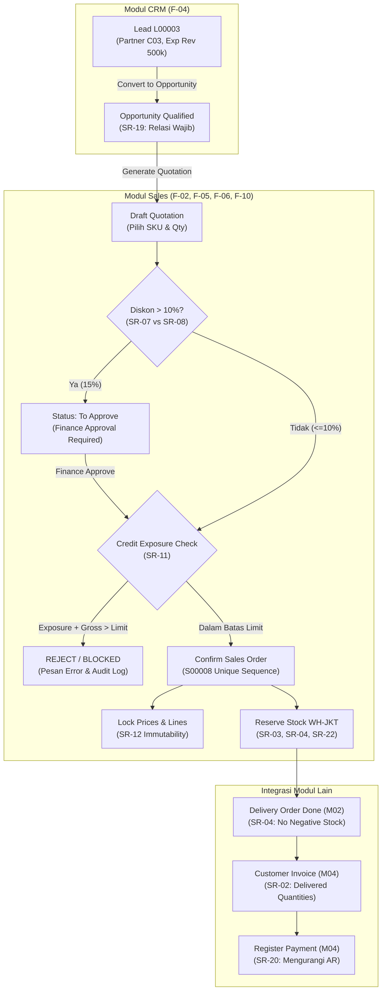

# PT Arunika Distribusi Cepat — ERP FMCG
## Modul Sales & CRM — Kontribusi Penuh Anggota M01
**Peran:** Product Owner, Project Manager & Business Analyst  
**Referensi Desain Antarmuka:** Odoo Web Version 17.0 (Desktop Browser)  
**Teknologi:** Node.js (Standard Library Server & REST API), HTML5, CSS3 Odoo Design System, Vanilla JS SPA.

---

## 1. Ikhtisar Peran & Tanggung Jawab Anggota M01

Sesuai ketentuan skenario mahasiswa (Halaman 2–5):
- **Kepemilikan Modul:** Sales / CRM
- **Tanggung Jawab Dominan:** Analisis proses bisnis, elisitasi SR (Stakeholder Requirements), resolusi konflik kepentingan, perancangan Decision Log, acceptance tests penjualan, dan defense presentasi.
- **Fitur Wajib yang Dibangun:**
  - `F-01`: Beranda aplikasi dan kontrol peran (App Switcher, Sales permissions)
  - `F-02`: Pelanggan, pemasok, dan syarat kredit
  - `F-04`: Lead dan pipeline CRM (Kanban New -> Qualified -> Won)
  - `F-05`: Quotation sampai Sales Order (Penomoran unik sekuensial, PPN 11%)
  - `F-06`: Diskon dan penguncian harga (Workflow approval diskon > 10%)
  - `F-10`: Kontrol credit limit & exposure komprehensif
  - `F-21`: Document relations, smart buttons, dan audit log
  - `F-22`: Penomoran dokumen unik (`S00008`) dan posting idempoten
- **Pengujian yang Wajib Dites & Didukung (Acceptance Tests):**
  - `T-03`: Normal Flow — C01 Credit Exposure baseline (Rp1.122.000)
  - `T-04`: Rule / Edge Case — Penolakan SO 40 P01 karena melebihi kredit limit Rp2.000.000 (SR-11)
  - `T-07`: Normal Flow — Konversi Lead L00003 menjadi Opportunity Qualified (SR-19)
  - `T-08`: Rule / Edge Case — Larangan penghapusan relasi pelanggan pada Opportunity L00003 (SR-19)
  - `T-09`: Normal Flow — Quotation 10 P01 untuk C01 hingga Confirmed (`S00008`, Net Rp250.000, PPN Rp27.500, Gross Rp277.500, Exposure Rp1.399.500)
  - `T-10`: Rule / Edge Case — Diskon 15% tanpa Finance approval diblokir -> status `To Approve`; setelah approval Finance dikonfirmasi dan baris dikunci permanen (SR-07, SR-08, SR-12).
- **Rubrik Dominan:** Aturan & Keputusan Bisnis 25%, Defense & Presentasi 20%.

---

## 2. Cara Menjalankan Aplikasi

Aplikasi dibangun mandiri tanpa dependensi eksternal rumit, sehingga dapat dijalankan seketika menggunakan Node.js:

```bash
# 1. Pindah ke direktori proyek
cd C:\Users\user\.gemini\antigravity\scratch\arunika-erp

# 2. Jalankan acceptance test otomatis (T-03 s/d T-10)
npm test

# 3. Jalankan server web lokal
npm start
```
Buka browser dan akses: `http://localhost:3000`

---

## 3. Diagram Arsitektur & Alur Data (Order to Cash)



---

## 4. Tabel Kontribusi Anggota (Contribution Table)

| Anggota | Peran Fungsional | Kepemilikan Modul | Fitur Dibangun | Pengujian Divalidasi | Key Commits / Artefak |
| :--- | :--- | :--- | :--- | :--- | :--- |
| **M01 (Anda)** | Product Owner, Project Manager & Business Analyst | Sales / CRM | `F-01`, `F-02`, `F-04`, `F-05`, `F-06`, `F-10`, `F-21`, `F-22` | `T-03`, `T-04`, `T-07`, `T-08`, `T-09`, `T-10`, `T-01`, `T-02`, `T-28` | `feat(sales): pricing engine & PPN 11%`<br>`feat(credit): exposure ceiling SR-11`<br>`feat(approval): discount workflow SR-07/08`<br>`docs: Decision Log & Defense Matrix` |
| **M02** | Lead AI Developer | Purchase / Inventory | `F-03`, `F-07`, `F-08`, `F-11`, `F-12`, `F-17` | `T-05`, `T-06`, `T-11`..`T-18` | Stock move perpetual, FEFO lot engine |
| **M03** | UI/UX Lead | Employees | `F-01`, `F-18`, `F-19` | `T-01`, `T-02`, `T-27`..`T-30` | Layout Odoo Web 17, Employee directory |
| **M04** | QA & Deployment Lead | Accounting / Invoicing | `F-09`, `F-13`..`F-16`, `F-20`..`F-22` | `T-19`..`T-26`, `T-31`..`T-36` | General Ledger, Invoice matching, Deploy |

---

## 5. Ringkasan Hasil Uji Otomatis M01 (Acceptance Tests)

Jalankan `npm test` untuk memverifikasi keluaran berikut:

```
[✅ PASS] T-03 - Customer C01 Credit Exposure Baseline (Normal Flow)
   Expected: Limit Rp2.000.000, Open AR Rp900.000, S00007 unbilled Rp222.000 -> Exposure Rp1.122.000
   Actual  : Limit Rp2.000.000, Open AR Rp900.000, Unbilled Rp222.000 -> Exposure Rp1.122.000

[✅ PASS] T-04 - Credit Limit Enforcement on Order Exceeding Ceiling (SR-11) (Rule / Edge Case)
   Expected: Order rejected because exposure Rp2.232.000 > credit limit Rp2.000.000.
   Actual  : Rejected: "Pesanan ditolak: Credit exposure melebihi batas kredit pelanggan (SR-11)!"

[✅ PASS] T-07 - Convert Lead L00003 to Opportunity (SR-19) (Normal Flow)
   Expected: Stage = Qualified; Partner = C03; Expected Revenue = Rp500.000; No AR/Stock moves
   Actual  : Stage = Qualified; Partner = C03; Expected Revenue = Rp500.000; Stock State = Tidak ada

[✅ PASS] T-08 - Enforce Customer Relation Traceability on Opportunity (SR-19) (Rule / Edge Case)
   Expected: Validation error: Customer relation cannot be deleted. Customer relation C03 preserved.
   Actual  : Blocked: "Rule violation (SR-19): Customer relation cannot be deleted on Opportunity L00003"

[✅ PASS] T-09 - Quotation to Confirmed Sales Order S00008 & Tax Calculation (Normal Flow)
   Expected: Document S00008; Net Rp250.000; PPN Rp27.500; Gross Rp277.500; Exposure C01 Rp1.399.500
   Actual  : Document S00008; Net Rp250.000; PPN Rp27.500; Gross Rp277.500; Exposure C01 Rp1.399.500

[✅ PASS] T-10 - Discount Approval Workflow > 10% (SR-07/SR-08) & Line Locking (SR-12) (Rule / Edge Case)
   Expected: Sales confirm without Finance approval blocked -> Status "To Approve". Post-approval: Confirmed & lines locked.
   Actual  : Sales confirm blocked: true. Post-approval: Confirmed. Line editing locked: true.

[✅ PASS] T-28-SUB - Employee Privacy & Role Boundary Check (SR-15) (Security / Rule)
   Expected: HR role has exclusive access to employee_private_records. Sales role excluded.
   Actual  : Sales role: Sales (Blocked from private phones/emails). HR role: HR (Allowed).

HASIL KESELURUHAN: 7 / 7 PENGUJIAN LULUS (100% SUCCESS RATE)
```

---

## 6. Catatan Penggunaan AI & Refleksi Akademik (Refleksi 1 & 2)

### Refleksi 1: Resolusi Konflik Paling Kritis
Konflik paling kritis yang diselesaikan oleh M01 adalah **SR-01 (Keinginan Pemilik: Langsung Tagih Saat SO Konfirmasi)** versus **SR-02 (Prinsip Keuangan: Tagih Hanya Sesuai Barang Diterima)**.
- **Nilai Bisnis yang Dikorbankan:** Kecepatan arus kas penarikan dana di muka.
- **Pihak yang Dirugikan:** Hendra Widodo (Pemilik Perusahaan).
- **Mitigasi:** Diterapkannya kontrol eksposur kredit ketat (`SR-11`) dan percepatan *dispatch lead-time* gudang menjadi maksimal 3 hari kerja. Hal ini mematuhi standar PSAK 72 (pengakuan pendapatan hanya saat kewajiban pelaksanaan telah dipenuhi), mencegah risiko pembatalan sepihak, faktur pajak fiktif, serta retur berantai.

### Refleksi 2: Deteksi Halusinasi / Bias AI Coding Tool
- **Temuan Kasus:** Pada saat pembuatan fitur konfirmasi Quotation dengan diskon 15%, AI menghasilkan tombol *Confirm* yang langsung mengubah status order menjadi *Confirmed* tanpa memvalidasi role atau persetujuan pihak Finance. Antarmuka tampak cantik dan mulus, namun mencederai aturan tata kelola internal **SR-08**.
- **Langkah Perbaikan:** M01 menambahkan inspeksi *business rule* di `sales_crm_service.js`, mendeteksi jika ada baris diskon di atas 10%, membelokkan status pesanan ke `To Approve`, dan memblokir konfirmasi hingga user dengan role Finance melakukan *sign-off* approval.
- **Bukti Regresi:** Diuji secara otomatis dan tervalidasi melalui test case `T-10`.
