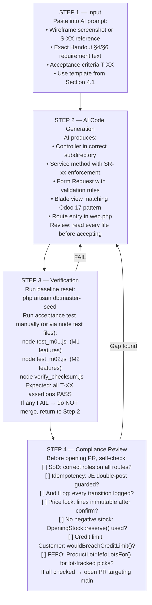

# AI Workflow, Coding Protocol & Repository Skeleton
## PT Arunika Distribusi Cepat — FMCG ERP System
**Requirement:** M2-W1-03 · Handout §8 — Team Coding Standards & AI Orchestration Guide  
**Last updated:** November 2026  

---

## Table of Contents

1. [Repository Directory Skeleton](#1-repository-directory-skeleton)
2. [Module Ownership Map](#2-module-ownership-map)
3. [Naming Conventions](#3-naming-conventions)
4. [Base AI Prompt Templates](#4-base-ai-prompt-templates)
5. [AI Coding Workflow Protocol](#5-ai-coding-workflow-protocol)
6. [Segregation of Duties (SoD) Checklist](#6-segregation-of-duties-sod-checklist)
7. [Idempotency & Audit Compliance Rules](#7-idempotency--audit-compliance-rules)
8. [Git Branch & Commit Convention](#8-git-branch--commit-convention)
9. [Quick-Start Commands](#9-quick-start-commands)

---

## 1. Repository Directory Skeleton

The tree below shows the **complete target layout** of the Laravel project.  
Items marked `[EXISTS]` are already in the repository. Items marked `[NEEDED]` must be created by the responsible member before their first feature commit.

```
arunika-fmcg-erp-system/
│
├── app/
│   ├── Console/
│   │   └── Commands/
│   │       └── RunFmcgMasterSeed.php          [EXISTS] — DDL + full §4 seed
│   │
│   ├── Http/
│   │   ├── Controllers/
│   │   │   ├── AuthController.php             [EXISTS]
│   │   │   ├── EmployeeController.php         [EXISTS] — M3
│   │   │   ├── AuditController.php            [EXISTS] — shared
│   │   │   ├── AccountingController.php       [EXISTS] — M4
│   │   │   │
│   │   │   ├── Sales/                         [NEEDED] — M1 owns
│   │   │   │   ├── LeadController.php
│   │   │   │   ├── QuotationController.php
│   │   │   │   └── SalesOrderController.php
│   │   │   │
│   │   │   ├── Purchase/                      [NEEDED] — M2 owns
│   │   │   │   ├── RfqController.php
│   │   │   │   └── PurchaseOrderController.php
│   │   │   │
│   │   │   └── Inventory/                     [NEEDED] — M2 owns
│   │   │       ├── ReceiptController.php
│   │   │       ├── DeliveryController.php
│   │   │       ├── StockTransferController.php
│   │   │       └── ProductController.php
│   │   │
│   │   ├── Middleware/
│   │   │   ├── CheckRole.php                  [EXISTS] — RBAC gate
│   │   │   ├── Authenticate.php               [EXISTS]
│   │   │   └── VerifyCsrfToken.php            [EXISTS]
│   │   │
│   │   └── Requests/                          [NEEDED — all members]
│   │       ├── Sales/
│   │       │   ├── ConfirmSalesOrderRequest.php
│   │       │   └── StoreQuotationRequest.php
│   │       ├── Purchase/
│   │       │   ├── ConfirmPurchaseOrderRequest.php
│   │       │   └── StoreRfqRequest.php
│   │       └── Inventory/
│   │           ├── ValidateReceiptRequest.php
│   │           └── ValidateDeliveryRequest.php
│   │
│   ├── Models/
│   │   ├── User.php                           [EXISTS]
│   │   ├── Department.php                     [EXISTS]
│   │   ├── Employee.php                       [EXISTS]
│   │   ├── EmployeePrivateRecord.php          [EXISTS]
│   │   ├── AuditLog.php                       [EXISTS]
│   │   ├── ChartOfAccount.php                 [EXISTS]
│   │   ├── Invoice.php                        [EXISTS]
│   │   ├── InvoiceItem.php                    [EXISTS]
│   │   ├── JournalEntry.php                   [EXISTS]
│   │   ├── Customer.php                       [EXISTS]
│   │   ├── Vendor.php                         [EXISTS]
│   │   ├── Product.php                        [EXISTS]
│   │   ├── VendorPricelist.php                [EXISTS]
│   │   ├── WarehouseLocation.php              [EXISTS]
│   │   ├── OpeningStock.php                   [EXISTS]
│   │   ├── ProductLot.php                     [EXISTS]
│   │   ├── TaxRate.php                        [EXISTS]
│   │   ├── PaymentTerm.php                    [EXISTS]
│   │   │
│   │   └── [NEEDED — M1/M2 transaction models]
│   │       ├── Lead.php                       — M1
│   │       ├── SalesOrder.php                 — M1
│   │       ├── SalesOrderLine.php             — M1
│   │       ├── Delivery.php                   — M2
│   │       ├── DeliveryLine.php               — M2
│   │       ├── PurchaseOrder.php              — M2
│   │       ├── PurchaseOrderLine.php          — M2
│   │       └── Receipt.php                    — M2
│   │
│   ├── Services/
│   │   ├── AccountingService.php              [EXISTS] — M4: invoice, JE, payment
│   │   ├── SalesCrmService.php                [NEEDED] — M1: lead, SO, credit check
│   │   ├── PurchaseService.php                [NEEDED] — M2: PO, 3-way match
│   │   └── InventoryService.php               [NEEDED] — M2: stock move, FEFO, transfer
│   │
│   └── Providers/
│       ├── AppServiceProvider.php             [EXISTS]
│       ├── AuthServiceProvider.php            [EXISTS]
│       └── RouteServiceProvider.php           [EXISTS]
│
├── database/
│   ├── migrations/
│   │   ├── 2014_10_12_000000_create_users_table.php              [EXISTS]
│   │   ├── 2026_10_26_000000_create_fmcg_employees_tables.php    [EXISTS]
│   │   ├── 2026_10_26_100000_create_audit_logs_table.php         [EXISTS]
│   │   ├── 2026_10_27_000000_create_accounting_tables.php        [EXISTS]
│   │   └── 2026_11_04_000000_create_fmcg_inventory_contacts_tables.php [EXISTS]
│   │   └── [NEEDED — M1/M2 transaction tables]
│   │       ├── 2026_11_XX_create_sales_tables.php                — M1
│   │       └── 2026_11_XX_create_purchase_inventory_tables.php   — M2
│   │
│   ├── seeders/
│   │   ├── DatabaseSeeder.php                 [EXISTS]
│   │   └── FmcgSeeder.php                     [EXISTS — legacy, superseded by Artisan command]
│   │
│   └── database.sqlite                        [EXISTS]
│
├── resources/views/
│   ├── layouts/                               [EXISTS] — shared master layout
│   ├── components/                            [EXISTS] — smart-button, log-notes, related-docs
│   ├── auth/                                  [EXISTS]
│   ├── home.blade.php                         [EXISTS] — App Switcher S-01
│   ├── employees/                             [EXISTS] — S-14, S-15
│   ├── reporting/                             [EXISTS] — S-18 Audit Log
│   ├── wireframes/                            [EXISTS] — S-01…S-18 mockups
│   │
│   └── [NEEDED per module]
│       ├── sales/                             — M1
│       │   ├── leads/
│       │   ├── quotations/
│       │   └── orders/
│       ├── purchase/                          — M2
│       │   ├── rfq/
│       │   └── orders/
│       ├── inventory/                         — M2
│       │   ├── products/
│       │   ├── receipts/
│       │   ├── deliveries/
│       │   └── transfers/
│       └── accounting/                        — M4 [NEEDED: bill/invoice views]
│           ├── invoices/
│           ├── bills/
│           ├── payments/
│           ├── ledger/
│           └── coa/
│
├── routes/
│   ├── web.php                                [EXISTS — auth + employees + accounting routes]
│   └── api.php                                [EXISTS]
│
├── docs/
│   ├── AI_WORKFLOW_AND_SKELETON.md            [THIS FILE]
│   └── [add decision logs, wireframe refs here]
│
└── [root-level legacy Node.js files — read-only reference]
    ├── sales_crm_service.js
    ├── purchase_inventory_service.js
    ├── accounting_invoicing_service.js
    ├── seed_data.js
    ├── data_store.json
    ├── test_m01.js / test_m02.js / test_m04.js
    └── verify_checksum.js
```

> **Rule:** Never put business logic in Controllers. Controllers validate input, call a Service, and return a view or JSON. All SR-xx rule enforcement lives in the Service layer or Model methods.

---

## 2. Module Ownership Map

| Member | Module | Controllers to create | Service to create | Views folder | Routes prefix |
| :--- | :--- | :--- | :--- | :--- | :--- |
| **M01** | Sales & CRM | `Sales/LeadController`<br>`Sales/QuotationController`<br>`Sales/SalesOrderController` | `SalesCrmService` | `resources/views/sales/` | `/crm`, `/sales` |
| **M02** | Purchase & Inventory | `Purchase/RfqController`<br>`Purchase/PurchaseOrderController`<br>`Inventory/ReceiptController`<br>`Inventory/DeliveryController`<br>`Inventory/StockTransferController` | `PurchaseService`<br>`InventoryService` | `resources/views/purchase/`<br>`resources/views/inventory/` | `/purchase`, `/inventory` |
| **M03** | Employees & HR | `EmployeeController` ✅ | — (logic in model/controller) | `resources/views/employees/` ✅ | `/employees` |
| **M04** | Accounting & Invoicing | `AccountingController` ✅ | `AccountingService` ✅ | `resources/views/accounting/` | `/accounting` |

---

## 3. Naming Conventions

### PHP / Laravel

| Artifact | Convention | Example |
| :--- | :--- | :--- |
| Controller | `PascalCase` + `Controller` suffix | `SalesOrderController` |
| Service | `PascalCase` + `Service` suffix | `SalesCrmService` |
| Model | `PascalCase` singular | `SalesOrder`, `PurchaseOrder` |
| Form Request | `PascalCase` + `Request` suffix | `ConfirmSalesOrderRequest` |
| Blade view | `kebab-case` in `snake_case` folders | `sales/orders/show.blade.php` |
| Route name | `module.resource.action` | `sales.orders.confirm` |
| Migration | `YYYY_MM_DD_HHMMSS_verb_noun_table` | `2026_11_10_create_sales_orders_table` |

### Document / Business IDs

| Entity | Format | Example |
| :--- | :--- | :--- |
| Sales Order | `S` + 5-digit zero-padded | `S00007`, `S00008` |
| Purchase Order | `PO` + 5-digit | `PO00007`, `PO00008` |
| Customer Invoice | `INV-` + 5-digit | `INV-00001` |
| Vendor Bill | `BILL-` + 5-digit | `BILL-00001` |
| Credit Note | `CN-` + 5-digit | `CN-00001` |
| Goods Receipt | `RCV-` + 5-digit | `RCV-00001` |
| Delivery Order | `DO-` + 5-digit | `DO-00001` |

---

## 4. Base AI Prompt Templates

Use these templates verbatim when prompting Kiro or any AI coding tool. Fill in the `[BRACKETED]` fields for each feature.

### 4.1 — Feature Build Prompt (Controller + Service + View)

```
Act as a Senior Laravel Developer.

ROLE:
You are building the [FEATURE_NAME] feature for PT Arunika Distribusi Cepat FMCG ERP.
Module owner: [M01 / M02 / M03 / M04]

CONTEXT:
- Framework: Laravel 10, PHP 8.1, SQLite (dev)
- All tables already exist. Use Eloquent models, never raw SQL.
- Business rule violations must throw \RuntimeException with the SR code in the message.
- Every state change must call AuditLog::record() from App\Models\AuditLog.
- All money amounts are stored as integers (Rupiah, no decimals).
- Tax: PPN 11% effective — floor(net * 0.11 + 0.5) per line.

FUNCTIONAL REQUIREMENT:
[Paste the exact Handout §4 / §6 requirement text here]

WIREFRAME REFERENCE:
Screen: [S-XX from Handout §9]
Key UI elements: [List / Kanban / Form view, status bar, smart buttons if applicable]
Odoo 17 pattern to emulate: [e.g. "Form view with status breadcrumb Draft→Confirmed→Done"]

EXISTING FILES TO READ FIRST (do not rewrite, only extend):
- app/Models/[RelevantModel].php
- app/Services/[ExistingService].php (if any)
- routes/web.php

FILES TO CREATE / MODIFY:
- app/Http/Controllers/[Module]/[Name]Controller.php
- app/Services/[Name]Service.php
- app/Http/Requests/[Module]/[Name]Request.php
- resources/views/[module]/[resource]/[action].blade.php
- routes/web.php  (add new route group)

ACCEPTANCE CRITERIA (from Handout §6 / T-XX):
[ ] [T-XX] Normal Flow: [describe expected happy-path result]
[ ] [T-XX] Rule / Edge Case: [describe the rejection scenario and expected error message]

COMPLIANCE CHECKLIST (mandatory — do not skip):
[ ] Segregation of Duties: Role gate added via CheckRole middleware?
    Allowed roles for this route: [Sales / Warehouse / Finance / Purchase / HR / Owner]
[ ] Idempotency: Does this action post a JournalEntry? If yes, idempotency_key must be
    built via JournalEntry::buildIdempotencyKey() and alreadyPosted() checked before insert.
[ ] Audit Log: AuditLog::record() called on every status transition and rejection?
[ ] Price Lock (SR-12 / SR-21): Are unit prices locked at document confirmation?
    If yes, lines must become read-only after confirm; controller must reject edits.
[ ] No Negative Stock (SR-04): If a stock move is triggered, check available qty before
    decrement via OpeningStock::reserve() — throws if insufficient.
[ ] Credit Limit (SR-11): If this is a Sales Order confirm, check Customer::wouldBreachCreditLimit().
[ ] FEFO (SR-07): If this is a Delivery picking lot-tracked SKUs, use ProductLot::fefoLotsFor().
```

### 4.2 — Bug-Fix / Regression Prompt

```
Act as a Senior Laravel Debugger.

CONTEXT: PT Arunika Distribusi Cepat FMCG ERP, Laravel 10, SQLite.

BUG DESCRIPTION:
[Describe exactly what happens vs what should happen]

FAILING TEST CASE:
[T-XX] — [paste the acceptance criteria]

FILES INVOLVED (read these first before making any change):
- [list relevant files]

DO NOT:
- Change any column names in existing migrations.
- Remove AuditLog::record() calls.
- Remove idempotency checks on JournalEntry.
- Alter the CheckRole middleware signature.

VERIFY AFTER FIX:
Run: php artisan db:master-seed  (to restore clean baseline)
Then manually reproduce [T-XX] and confirm the expected output.
```

### 4.3 — Blade View / UI Prompt

```
Act as a Senior Laravel Blade + Tailwind CSS Developer.
UI reference: Odoo 17 Desktop Browser.

SCREEN: [S-XX — screen name from Handout §9]
VIEW TYPE: [List / Kanban / Form]

LAYOUT REQUIREMENTS:
- Extend layouts.app (the master layout already in resources/views/layouts/).
- Top nav: App Switcher with active module highlighted.
- Status bar breadcrumb: [Draft → Confirmed → Done] (match exact Odoo style).
- Smart buttons: show related document counts (use components/smart-button.blade.php).
- Log notes / chatter: use components/log-notes.blade.php at bottom of Form view.

DATA PASSED FROM CONTROLLER:
[List $variables and their types]

REQUIRED UI ELEMENTS:
[ ] Filter bar (search, status dropdown, date range)
[ ] Action buttons with correct role visibility (hide if role not permitted)
[ ] Empty-state message when no records
[ ] Pagination (use Laravel paginate(20))
[ ] Mobile-responsive minimum: readable on 768px width

DO NOT use any external CSS framework other than Tailwind.
DO NOT introduce Alpine.js or Livewire — vanilla JS only.
```

---

## 5. AI Coding Workflow Protocol

Every feature follows this four-step gate before a PR can be merged.



### Step-by-Step Detail

#### Step 1 — Input Preparation

Before calling the AI, assemble:

1. **Wireframe reference** — screenshot of the Odoo 17 screen you are emulating, or the screen number `S-XX` from the handout's wireframe section.
2. **Functional spec** — copy the exact sentences from Handout §4/§6 for the feature.
3. **Acceptance criteria** — the full `T-XX` test case, including both Normal Flow and Rule/Edge Case.
4. **Existing file list** — tell the AI which files to read first (models, existing services, routes).
5. **Prompt template** — fill in Section 4.1 completely. Never submit a vague "build me a sales order" prompt without the SR references.

#### Step 2 — Code Generation Rules

When reviewing AI output, check the following **before** saving any file:

| Check | What to look for |
| :--- | :--- |
| No raw SQL | `DB::statement()` used only for PRAGMA in master seed; everywhere else use Eloquent |
| Exception messages | Must include `SR-XX Enforcement:` prefix so they are traceable |
| No silent failures | Every catch block either re-throws or calls `AuditLog::record()` with `action='error'` |
| Migration safety | AI must never alter an existing migration file — new columns = new migration |
| Money arithmetic | All amounts are integers; `round()` or `floor()` only at PPN calculation point |
| Timestamps | Always pass `created_at` / `updated_at` in raw `DB::table()->insert()` calls |

#### Step 3 — Verification Gates

| Gate | Command | Pass condition |
| :--- | :--- | :--- |
| Baseline reset | `php artisan db:master-seed` | All 16 tables created, 880 units, Rp23.095.000, Rp44.595.000 balanced |
| Checksum | `node verify_checksum.js` | 100% PASSED |
| M1 tests | `node test_m01.js` | 7/7 PASS |
| M2 tests | `node test_m02.js` | 5/5 PASS |
| PHP lint | `php -l app/path/to/NewFile.php` | `No syntax errors detected` |
| Artisan route list | `php artisan route:list --path=sales` | New routes appear with correct middleware |

#### Step 4 — Compliance Self-Review Checklist

Copy this into your PR description and tick every box:

```
## Compliance Checklist

### Segregation of Duties
- [ ] All new routes have `middleware('role:X,Y')` or `->middleware('role:X,Y')`
- [ ] No Finance-only action is accessible to Sales or Warehouse roles
- [ ] HR private records endpoint checks `auth()->user()->isHR()` explicitly

### Idempotency (SR-16)
- [ ] Every `JournalEntry::create()` is preceded by `JournalEntry::alreadyPosted($key)`
- [ ] Idempotency key built via `JournalEntry::buildIdempotencyKey()`
- [ ] No journal entry posted outside a `DB::transaction()` block

### Audit Trail
- [ ] `AuditLog::record()` called on: confirm, post, cancel, status_change, access_denied, sign_off_rejected
- [ ] `old_values` and `new_values` populated on all state transitions
- [ ] No state change exits without an audit log entry (including the error/rejection path)

### Business Rules
- [ ] SR-02: Customer invoice qty = delivered qty (not ordered qty)
- [ ] SR-04: Stock decrement uses `OpeningStock::reserve()` — throws on insufficient stock
- [ ] SR-06: Vendor bill qty = accepted receipt qty (3-way match)
- [ ] SR-07: Lot-tracked delivery uses `ProductLot::fefoLotsFor()`
- [ ] SR-11: SO confirm calls `Customer::wouldBreachCreditLimit()`
- [ ] SR-12: SO/PO lines are read-only after confirmation
- [ ] SR-13: Credit note qty ≤ `Invoice::maxCreditableQty()`
- [ ] SR-17/18: Delivery/Receipt sign-off calls `Employee::canSignOff()`
- [ ] SR-20: Payment amount ≤ outstanding amount
- [ ] SR-21: PO unit price locked from `VendorPricelist` at confirmation
```

---

## 6. Segregation of Duties (SoD) Reference

The `CheckRole` middleware enforces role gates on every protected route.

```php
// Usage in routes/web.php
Route::middleware('role:Sales,Owner')->group(function () { ... });
Route::middleware('role:Warehouse,Owner')->group(function () { ... });
Route::middleware('role:Finance,Owner')->group(function () { ... });
Route::middleware('role:Purchase,Owner')->group(function () { ... });
Route::middleware('role:HR,Owner')->group(function () { ... });
```

### Role → Module Access Matrix

| Role | Sales/CRM | Purchase | Inventory | Accounting | Employees | Audit Log |
| :--- | :---: | :---: | :---: | :---: | :---: | :---: |
| Sales | ✅ | ❌ | view only | ❌ | view only | own docs |
| Purchase | ❌ | ✅ | ✅ | ❌ | view only | own docs |
| Warehouse | ❌ | ❌ | ✅ full | ❌ | view only | own docs |
| Finance | ❌ | ❌ | ❌ | ✅ | view only | ✅ full |
| HR | ❌ | ❌ | ❌ | ❌ | ✅ full + private | own docs |
| Owner | ✅ | ✅ | ✅ | ✅ | ✅ | ✅ full |

### Key SoD Rules (from Handout §6)

- The person who **confirms a Sales Order** (Sales role) cannot also **post the resulting Invoice** (Finance role only).  
- The person who **receives goods** (Warehouse role) cannot also **create the Vendor Bill** (Finance role only).  
- HR is the **only role** that can read `employee_private_records` — enforced in `EmployeeController::show()`.  
- `Owner` bypasses functional restrictions but **all Owner actions are still fully audit-logged**.

---

## 7. Idempotency & Audit Compliance Rules

### How Idempotency Works

Every journal entry has a `idempotency_key` column (`UNIQUE` constraint in DB):

```php
// In any Service method — before inserting a JournalEntry:
$key = JournalEntry::buildIdempotencyKey($journalType, $reference, $debitAcc, $creditAcc, $amount);

if (JournalEntry::alreadyPosted($key)) {
    // SR-16: silently return the existing entry — do NOT throw or re-post
    return JournalEntry::where('idempotency_key', $key)->first();
}

return JournalEntry::create([...]);
```

This means the same posting action can be safely retried (network failure, double-click) without creating duplicate ledger entries.

### Audit Log — When to Call

```php
AuditLog::record(
    documentType: 'sales_order',       // snake_case entity name
    documentId:   'S00008',            // the document's business ID
    action:       'confirmed',         // past-tense verb
    actorUser:    auth()->user()->username,
    description:  'SO S00008 confirmed. C01, 10×P01, net Rp250k, gross Rp277.5k.',
    actorEmployee: auth()->user()->employee?->id,   // nullable
    oldValues:    ['status' => 'draft'],
    newValues:    ['status' => 'confirmed']
);
```

**Mandatory trigger points:**

| Trigger | `action` string |
| :--- | :--- |
| Document created | `created` |
| Document confirmed / posted | `confirmed` / `posted` |
| Document cancelled | `cancelled` |
| Status field changed | `status_changed` |
| Stock reserved | `reserve` |
| Sign-off accepted | `sign_off_authorized` |
| Sign-off rejected | `sign_off_rejected` |
| Access denied by RBAC | `access_denied` (auto-logged by `CheckRole`) |
| Payment registered | `payment_registered` |
| Credit note created | `credit_note_created` |

---

## 8. Git Branch & Commit Convention

### Branch naming

```
main                     — production-ready code only; protected
develop                  — integration branch
feature/m01-sales-order  — M01 feature work
feature/m02-receipt      — M02 feature work
fix/m04-invoice-tax      — bug fix
```

**Never push directly to `main`. Always open a PR from `feature/*` → `develop`.**

### Commit message format

```
<type>(<module>): <short imperative description>

type  : feat | fix | refactor | test | docs | style | chore
module: m01 | m02 | m03 | m04 | shared | db | docs

Examples:
feat(m01): add credit limit check on SO confirm (SR-11)
fix(m02): prevent double stock decrement on receipt retry (SR-04)
feat(db): add sales_orders and sales_order_lines tables
docs(shared): update AI_WORKFLOW_AND_SKELETON with M2 module map
chore(m04): remove debug dd() from AccountingController
```

### PR description template

```markdown
## Summary
[1–3 sentences describing what was built]

## Acceptance Tests Covered
- [ ] T-XX — [test name] — PASS
- [ ] T-XX — [test name] — PASS

## Compliance Checklist
[Paste and tick the full checklist from Section 5, Step 4]

## Baseline Reset Verified
- [ ] `php artisan db:master-seed` ran cleanly
- [ ] `node verify_checksum.js` → 100% PASSED
```

---

## 9. Quick-Start Commands

```bash
# Clone and install
git clone <repo-url> && cd arunika-fmcg-erp-system
composer install
cp .env.example .env
php artisan key:generate

# Full database reset — drops, recreates, and seeds all §4 data
php artisan db:master-seed

# Run Laravel dev server
php artisan serve
# → http://localhost:8000

# Run Node.js acceptance tests (legacy JS simulation layer)
node test_m01.js          # M1: 7 tests
node test_m02.js          # M2: 5 tests
node test_m04.js          # M4: accounting tests
node verify_checksum.js   # Baseline checksum: 880 units, Rp23.095.000

# Lint a PHP file before committing
php -l app/Http/Controllers/Sales/SalesOrderController.php

# List all registered routes
php artisan route:list

# Check which routes have role middleware
php artisan route:list --path=sales
php artisan route:list --path=purchase
php artisan route:list --path=inventory
php artisan route:list --path=accounting

# Create a new Form Request (run from project root)
php artisan make:request Sales/ConfirmSalesOrderRequest
php artisan make:request Purchase/ConfirmPurchaseOrderRequest
```

---

*Document owner: M01 (Project Manager / Business Analyst)*  
*Approved by: All members at M2-W1-03 kickoff*  
*Do not modify naming conventions or compliance rules without team consensus.*
